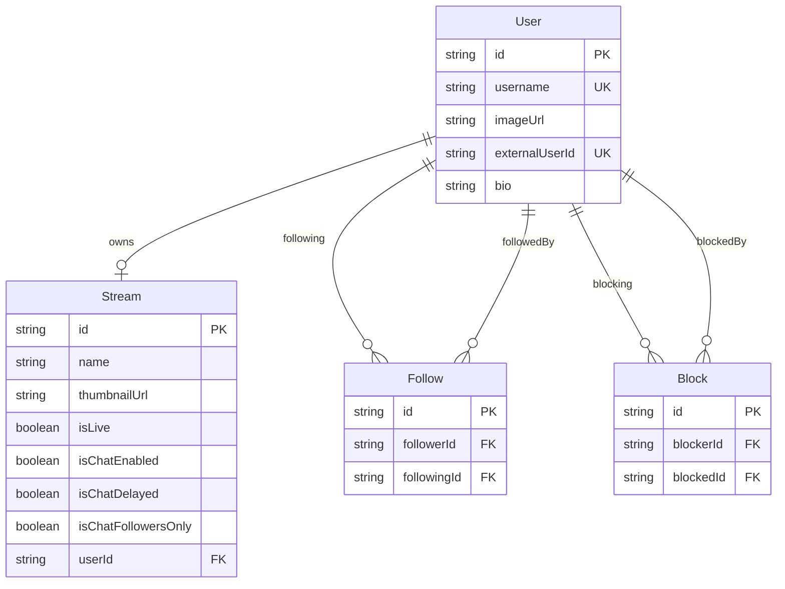

<!-- ──────────────────────────────────────────────────────────── -->
<!-- HERO -->
<!-- ──────────────────────────────────────────────────────────── -->

<div align="center">

<br />


<br />

# ✦ NexusLive

### Where creators and communities connect in real time

A full-featured live streaming platform built from the ground up with\
**Next.js 16**, **React 19**, **LiveKit**, and **PostgreSQL**.

<br />

[](https://nextjs.org/)
[](https://react.dev/)
[](https://www.typescriptlang.org/)
[](https://tailwindcss.com/)
[](https://www.prisma.io/)
[](https://livekit.io/)

<br />

[Features](#-features) · [Tech Stack](#-tech-stack) · [Quick Start](#-quick-start) · [Architecture](#-architecture) · [Scripts](#-scripts) · [Deployment](#-deployment)

<br />

</div>

<!-- ──────────────────────────────────────────────────────────── -->
<!-- OVERVIEW -->
<!-- ──────────────────────────────────────────────────────────── -->

## 🔍 Overview

**NexusLive** is a Twitch-style streaming platform where anyone can go live, build an audience, and interact through real-time chat. It combines [LiveKit](https://livekit.io/) for ultra-low-latency video, [Clerk](https://clerk.com/) for seamless authentication, [UploadThing](https://uploadthing.com/) for media uploads, and [Prisma](https://www.prisma.io/) + PostgreSQL for a rock-solid data layer — all wrapped in a modern, responsive UI with dark/light mode.

---

<!-- ──────────────────────────────────────────────────────────── -->
<!-- FEATURES -->
<!-- ──────────────────────────────────────────────────────────── -->

## ✨ Features

<table>
<tr>
<td width="50%" valign="top">

#### 📡 Live Streaming
Broadcast and watch real-time video streams powered by LiveKit with RTMP and WHIP ingress support.

#### 💬 Real-Time Chat
Stream-level chat with follower-only mode, slow mode (delayed messages), and a live community viewer list.

#### 🔐 Authentication
Sign up, sign in, and manage profiles via Clerk — with automatic user sync to the database through webhooks.

#### 🎛️ Creator Dashboard
Manage stream settings, generate connection keys, configure chat preferences, and moderate your community.

</td>
<td width="50%" valign="top">

#### 👥 Follow & Block
Follow your favorite creators to stay updated. Block unwanted users with full cascade cleanup.

#### 🔎 Full-Text Search
Find streams instantly with native PostgreSQL full-text search powered by Prisma's preview features.

#### 🖼️ File Uploads
Upload stream thumbnails and profile images through UploadThing with server-side validation.

#### 🌗 Dark / Light Mode
System-aware theme toggle that remembers your preference across sessions.

</td>
</tr>
</table>

> **SEO-first approach** — Every page ships with dynamic metadata, Open Graph tags, Twitter cards, JSON-LD structured data, an auto-generated sitemap, and `robots.txt`.

---

<!-- ──────────────────────────────────────────────────────────── -->
<!-- TECH STACK -->
<!-- ──────────────────────────────────────────────────────────── -->

## 🛠 Tech Stack

<table>
<tr>
  <th align="left">Layer</th>
  <th align="left">Technology</th>
</tr>
<tr>
  <td><strong>⚡ Framework</strong></td>
  <td>Next.js 16.3.0 — App Router, Server Actions, RSC</td>
</tr>
<tr>
  <td><strong>🎨 UI</strong></td>
  <td>React 19 · Tailwind CSS v4 · shadcn/ui (Radix Vega)</td>
</tr>
<tr>
  <td><strong>🔐 Auth</strong></td>
  <td>Clerk (<code>@clerk/nextjs</code> v7)</td>
</tr>
<tr>
  <td><strong>🗄️ Database</strong></td>
  <td>PostgreSQL via Prisma v7 (<code>@prisma/adapter-pg</code>)</td>
</tr>
<tr>
  <td><strong>📡 Streaming</strong></td>
  <td>LiveKit — client SDK + server SDK</td>
</tr>
<tr>
  <td><strong>📁 Uploads</strong></td>
  <td>UploadThing</td>
</tr>
<tr>
  <td><strong>🧠 State</strong></td>
  <td>Zustand v5</td>
</tr>
<tr>
  <td><strong>🎯 Icons</strong></td>
  <td>Lucide React</td>
</tr>
</table>

---

<!-- ──────────────────────────────────────────────────────────── -->
<!-- QUICK START -->
<!-- ──────────────────────────────────────────────────────────── -->

## 🚀 Quick Start

### Prerequisites

| Tool | Version |
| --- | --- |
| [Node.js](https://nodejs.org/) | 20+ |
| [PostgreSQL](https://www.postgresql.org/) | Any recent version |
| [ngrok](https://ngrok.com/) | For local webhook tunneling |

### 1 · Clone & Install

```bash
git clone https://github.com/BhushanLagare7/nextjs16-twitch-clone.git
cd nextjs16-twitch-clone
npm install
```

> [!NOTE]
> `npm install` automatically runs `prisma generate` via the `postinstall` script — no extra step needed.

### 2 · Configure Environment

```bash
cp .env.example .env
```

<details>
<summary><strong>📋 Required environment variables</strong></summary>

<br />

| Variable | Service | Description |
| --- | --- | --- |
| `DATABASE_URL` | PostgreSQL | Connection string |
| `NEXT_PUBLIC_CLERK_PUBLISHABLE_KEY` | Clerk | Publishable key |
| `CLERK_SECRET_KEY` | Clerk | Secret key |
| `CLERK_WEBHOOK_SECRET` | Clerk | Webhook verification secret |
| `LIVEKIT_API_URL` | LiveKit | Server URL |
| `LIVEKIT_API_KEY` | LiveKit | API key |
| `LIVEKIT_API_SECRET` | LiveKit | API secret |
| `LIVEKIT_WEBHOOK_SECRET` | LiveKit | Webhook verification secret |
| `UPLOADTHING_TOKEN` | UploadThing | Access token |
| `NEXT_PUBLIC_APP_URL` | App | Public URL (SEO, sitemaps, webhooks) |

</details>

### 3 · Set Up the Database

```bash
# Run migrations
npm run db:migrate

# Or push schema directly (skip migration files)
npm run db:push
```

### 4 · Start Developing

```bash
npm run dev
```

Open **[http://localhost:3000](http://localhost:3000)** and you're live! 🎉

> [!TIP]
> To receive Clerk and LiveKit webhooks locally, start ngrok in a separate terminal:
> ```bash
> npm run ngrok
> ```
> Then point your webhook endpoints in the Clerk and LiveKit dashboards to the ngrok URL.

---

<!-- ──────────────────────────────────────────────────────────── -->
<!-- ARCHITECTURE -->
<!-- ──────────────────────────────────────────────────────────── -->

## 🏗 Architecture

```
nextjs16-twitch-clone/
│
├── app/
│   ├── (auth)/               # 🔐 Sign-in / Sign-up (Clerk)
│   ├── (browse)/             # 🏠 Home feed, user profiles, search
│   │   ├── (home)/           #    Landing page
│   │   ├── [username]/       #    User profile pages
│   │   └── search/           #    Full-text search
│   ├── (dashboard)/u/        # 🎛️ Creator dashboard
│   │   ├── keys/             #    Stream connection keys
│   │   ├── chat/             #    Chat preferences
│   │   └── community/        #    Block / unblock users
│   └── api/
│       ├── uploadthing/      # 📁 File upload routes
│       └── webhooks/
│           ├── clerk/        # 🔄 User sync webhook
│           └── livekit/      # 📡 Stream status webhook
│
├── actions/                  # ⚡ Server Actions
├── components/
│   ├── stream-player/        # 🎬 23-component stream player
│   ├── ui/                   # 🧩 shadcn/ui primitives
│   └── seo/                  # 🔍 JSON-LD structured data
├── lib/                      # 📚 Service layer & utilities
├── hooks/                    # 🪝 React hooks
├── store/                    # 🧠 Zustand stores
├── prisma/                   # 🗄️ Schema & migrations
└── generated/prisma/         # ⚙️ Auto-generated client (gitignored)
```

### Data Models



---

<!-- ──────────────────────────────────────────────────────────── -->
<!-- SCRIPTS -->
<!-- ──────────────────────────────────────────────────────────── -->

## 📜 Scripts

| Command | Description |
| :--- | :--- |
| `npm run dev` | 🟢 Start the development server |
| `npm run build` | 📦 Create a production build |
| `npm start` | 🚀 Start the production server |
| `npm test` | 🧪 Run all tests |
| `npm run lint` | 🔍 Lint the project |
| `npm run lint:fix` | 🔧 Lint and auto-fix issues |
| `npm run db:generate` | ⚙️ Generate the Prisma client |
| `npm run db:migrate` | 🗄️ Run database migrations |
| `npm run db:push` | 📤 Push schema changes directly |
| `npm run db:studio` | 🖥️ Open Prisma Studio |
| `npm run ngrok` | 🌐 Expose localhost for webhooks |

---

<!-- ──────────────────────────────────────────────────────────── -->
<!-- WEBHOOKS -->
<!-- ──────────────────────────────────────────────────────────── -->

## 🔗 Webhook Endpoints

| Endpoint | Source | Purpose |
| :--- | :---: | :--- |
| `/api/webhooks/clerk` |  | Syncs user create / update / delete to the database |
| `/api/webhooks/livekit` |  | Updates stream live status on ingress events |

---

<!-- ──────────────────────────────────────────────────────────── -->
<!-- DEPLOYMENT -->
<!-- ──────────────────────────────────────────────────────────── -->

## 🚢 Deployment

```bash
npm run build
npm start
```

> [!IMPORTANT]
> The `generated/` directory is **gitignored**. CI/CD pipelines must run `prisma generate` before building — this is handled automatically by the `postinstall` script when running `npm install`.

> [!NOTE]
> Remote images are allowed from `utfs.io`, `ufs.sh`, and `*.ufs.sh` (UploadThing CDN), configured in [`next.config.ts`](./next.config.ts).

---

<div align="center">

<br />

Built with ❤️ using **Next.js 16** · **React 19** · **LiveKit** · **Prisma**

<br />

</div>
